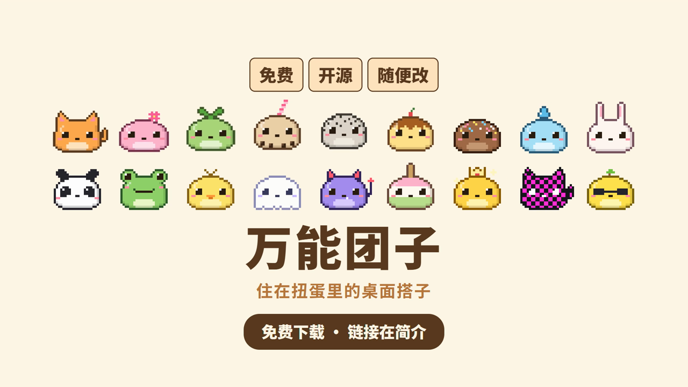
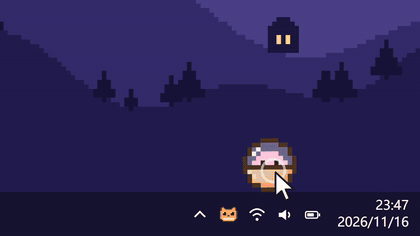
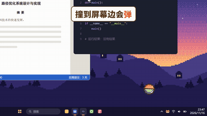
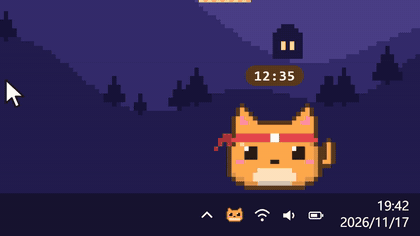
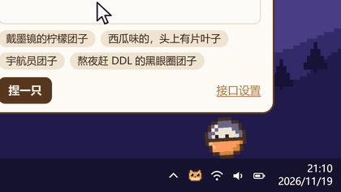
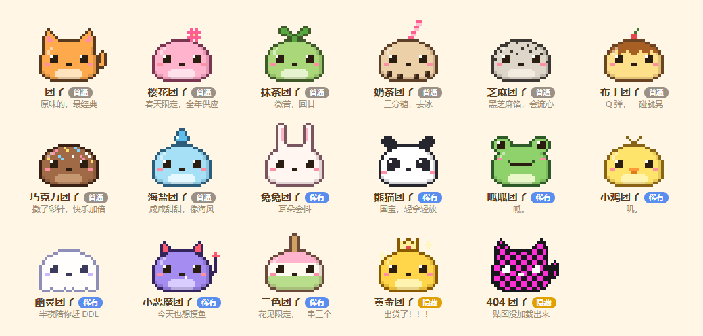

# 万能团子

> 住在扭蛋里的像素桌宠。点一下开扭蛋，能拎能甩，会陪你专注、帮你数 DDL，还能让 AI 捏一只新的。



**[⬇ 点这里下载安装包](https://github.com/zzr223/dango-pet/releases/latest/download/dango-pet-setup.exe)** · Windows 10 / 11 · 免费 · 开源 · 随便改

第一次装？看下面的 [下载和安装](#下载和安装)，三步。

| 开扭蛋 | 甩出去 |
|:---:|:---:|
|  |  |
| **陪你专注** | **让 AI 捏一只** |
|  |  |

## 它会什么

| | |
|---|---|
| **开扭蛋** | 点一下，蹦出一只团子。17 种，每次都可能不一样，还有 2% 的隐藏款。右键「图鉴」看收集进度 |
| **拎和甩** | 按住能拖走；快速一甩会飞出去，撞屏幕边反弹、落地滚停。甩狠了会晕，连着甩会生气 |
| **会看你** | 鼠标靠近，扭蛋里那只会睁眼跟着看；停一会儿，它还会掀开盖子探头 |
| **专注** | 右键 → 专注 25 / 45 / 60 分钟。它绑上头带陪着你，到点撒花，记下今天第几个 |
| **倒计时** | 加上考试、DDL 的日期，每天第一次见面它会报还有几天 |
| **提醒** | 连续用电脑 45 分钟，喊你起来走走；23:30 以后催你睡觉。右键里都能关 |
| **改装** | 17 只不够？右键让 AI 捏一只，或者自己写个配方；别人做的扩展包，右键「添加扩展包」选一下就装上；扭蛋的样子、出场和变身的动画都能换 |
| **不打扰** | 没事就安静待在扭蛋里。窗口透明的地方点得穿，不会挡住你点别的东西 |

## 下载和安装

| | 点链接直接下载 | 大小 |
|---|---|---|
| **安装版**（推荐） | **[dango-pet-setup.exe](https://github.com/zzr223/dango-pet/releases/latest/download/dango-pet-setup.exe)** | 约 92 MB |
| 免安装版 | [dango-pet-win-x64.zip](https://github.com/zzr223/dango-pet/releases/latest/download/dango-pet-win-x64.zip) | 约 119 MB |

不用注册、不用登录。历史版本在 [Releases](https://github.com/zzr223/dango-pet/releases) 页。

**安装版，三步：**

1. 双击下载好的 `dango-pet-setup.exe`。
2. Windows 如果弹出蓝色的「已保护你的电脑」：点「更多信息」→「仍要运行」。个人开源软件没有买代码签名证书，所以会有这个提示；浏览器下载时说「不常下载」也是同一个原因，选「保留」。
3. 选安装位置，点「安装」。打开第一页就是选位置，**默认不占 C 盘**：电脑里有 D 盘这类别的硬盘分区就默认装到那里，想换直接改路径。几秒钟装完，扭蛋出现在屏幕右下角，点它一下试试。

不需要管理员权限。以后升级：下载新的安装包再装一遍，图鉴和设置都还在。

**免安装版**：把 zip 解压到任意位置（哪个盘都行），双击里面的 `万能团子.exe`。

**卸载**：系统「设置 → 应用」里找到「万能团子」卸载。存档（一两 MB）在 `%APPDATA%\dango-pet`，想清干净就把这个文件夹也删掉。

## 团子图鉴



概率公示：普通 78% · 稀有 20% · 隐藏 2%。在图鉴里点一只见过的，可以让它常驻。

## 常见问题

- **团子不见了**：右键任务栏右下角托盘里的团子图标 →「回到右下角」。
- **想让它安静点**：右键 →「勿扰」，它就不会自己跑出来了。
- **开机自动启动**：右键 →「开机自启」。
- **想换安装位置**：再运行一次安装包，在第一页改路径，旧位置会自动清掉，图鉴和设置不受影响。
- **会不会偷偷联网、收集数据**：不会。默认不发任何网络请求，图鉴和设置只存在你电脑上的 `%APPDATA%\dango-pet\`。唯一会联网的是「AI 捏团子」：你自己填了接口、点了「捏一只」的那一下，才会把你写的那句话发给你填的那个地址。代码都在这个仓库里，可以自己看。

## 改装团子

| 想做的事 | 怎么做 |
|---|---|
| 要一只新团子，不想动手 | 右键 →「AI 捏团子」，填上自己的 AI 接口，说一句话 |
| 用别人做的扩展包 | 右键 →「添加扩展包…」，选对方给的 `.json`，马上生效 |
| 自己调颜色、加小配件 | 写一个十来行的「配方」文件，同样用「添加扩展包…」加进来 |
| 换扭蛋的样子 | 图鉴最下面的「扭蛋」一栏 |
| 换出场和变身的动画、给右键加一项菜单 | 在扩展包里写几个字段 |

扩展包就是一个 `.json` 文件，里面只有数据、没有代码，可以放心装别人做的。仓库里有个现成的例子 [天气团子](examples/packs/天气团子.json)：下载下来添加，会多出四只能互相变身的团子和一个带指示灯的扭蛋。

配方怎么写、每个字段什么意思，见 [改装指南](docs/改装指南.md)。装好的扩展包都在 `%APPDATA%\dango-pet\dangos\`，图鉴最下面有入口。

「AI 捏团子」默认用 Claude，也可以填别家的 OpenAI 兼容接口或本机模型。密钥加密存在你电脑上。

## 从源码运行

需要 [Node.js](https://nodejs.org) 18 以上。

```
git clone https://github.com/zzr223/dango-pet.git
cd dango-pet
npm install
npm start        # 运行
npm test         # 跑自测
npm run dist     # 打安装包和免安装 zip，产物在 dist/
```

想改它：

| 文件 | 管什么 |
|---|---|
| `src/sprites.js` | 团子长什么样。加一只新团子 = 在 `FORMS` 里照着抄一段 |
| `src/lines.js` | 它说的话 |
| `src/core.js` | 逻辑：拖拽、甩飞、抽扭蛋、专注、提醒、扩展包 |
| `src/packs.js` | 扩展包的读写：文件夹里有哪些包、添加一个包 |
| `src/ai.js` | AI 捏团子：给模型的说明、怎么调接口 |
| `src/pet.html` | 动画 |
| `src/bubble.html` | 气泡和卡片 |
| `build/installer.nsh` | 安装包：选位置那一页、默认装到哪个盘 |

## 插件

不用改源码也能加功能：在 `%APPDATA%\dango-pet\plugins\` 里放一个 `.js` 文件，重启团子生效。

```js
// 每小时提醒喝水
module.exports = (团子) => {
  setInterval(() => 团子.nudge('喝口水吧'), 3600e3);
  团子.on('poke', () => console.log('被戳了'));
};
```

| 方法 | 作用 |
|---|---|
| `nudge(文字)` | 团子自己出来，头顶冒一句话 |
| `toast(文字)` | 只冒一句话 |
| `say(标题, 内容)` | 弹一张卡片 |
| `setCount(n)` | 有 n 件事：团子出来蹦着叫你，头顶显示数字；`0` 回扭蛋 |
| `setMood(m)` | `busy` / `happy` / `sad` / `sleep`，`''` 恢复 |
| `on(事件, 函数)` | `poke` 被点了 / `seen` 出来了一只 / `focus-done` 专注完成 |

更多例子见 [`examples/plugins`](examples/plugins)。

## 请团子喝杯奶茶

团子永远免费。觉得好用，随手打赏一点就行；不打也完全没关系。


## 许可

[MIT](LICENSE)。团子的形象和代码都是原创，欢迎拿去改、拿去玩。
